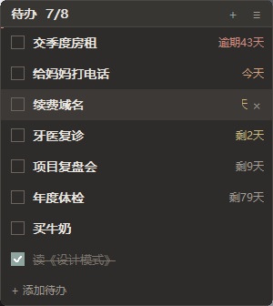
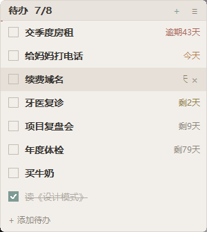
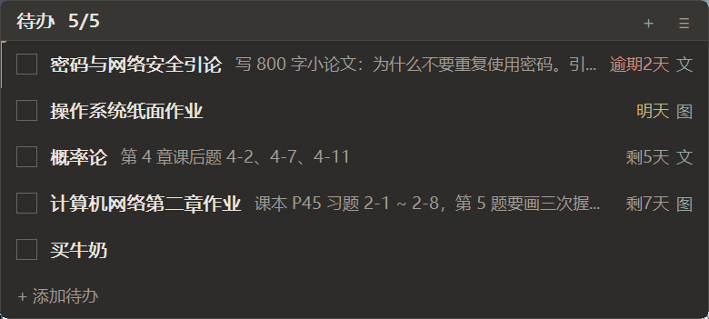
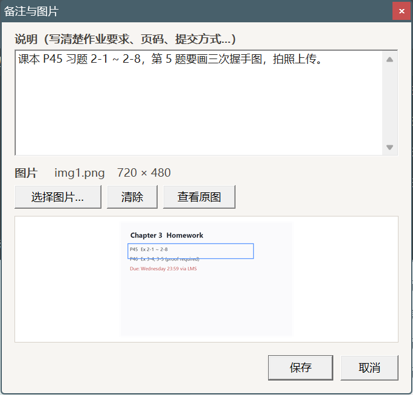
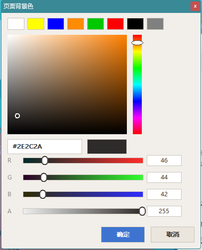
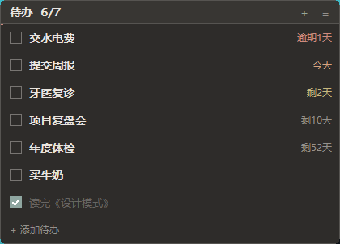
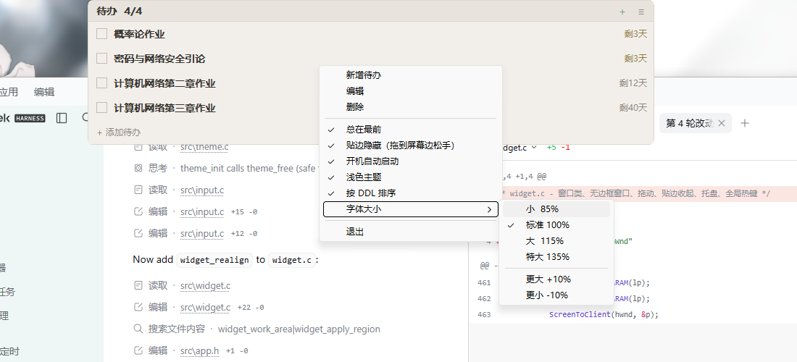
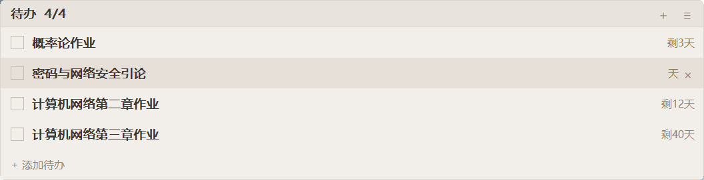

# desk-todo-chaoxing · 桌面待办 + 学习通作业同步

一个常驻桌面的迷你待办清单：无边框悬浮小窗，随手输入待办和 DDL，按紧急程度自动配色；
点一下「立即同步学习通」就能把**超星/学习通上当前学期的未完成作业**抓成待办。
**纯 Win32 API + GDI 手绘，C11 静态编译单文件 exe，无任何运行时依赖。**




<sub>截图里的待办是示例数据，实际首次启动是空列表。</sub>

> 学习通同步是**模拟登录 + 页面解析**，仅供个人备份自己的作业清单使用。请遵守学校与平台的
> 使用规定，不要用来批量抓取他人数据或做高频请求（脚本里有配速与限流退避）。

---

## 快速开始

```bat
:: 编译（需要 MinGW-w64 gcc，路径写在 build.bat 里）
build.bat

:: 运行
out\DeskTodo.exe
```

产物：`out\DeskTodo.exe`（约 442 KB，双击即用，无需安装）。

关闭窗口 = 收进托盘，程序继续在后台；要真正退出请用右键菜单 → **退出**。

---

## 功能

### 记待办
- 点底部 **+ 添加待办**，或直接按 `Enter`，或直接敲任意字符，都能开始输入。
- 一行文本连 DDL 一起写完回车即可，例如 `提交周报 明天 18:00`、`开周会 下周一 9:30`。
- 学习通上的作业/考试可以一键拉进来（见下面的「学习通作业同步」）。

### DDL 自然语言识别
标题里自动识别并抽出一个日期 + 一个时间（可放在标题前或标题后，其余文字原样保留为标题）：

| 写法 | 例 |
| --- | --- |
| 相对日 | `今天` `明天` `后天` `大后天` |
| 星期 | `周三` `星期四` `下周一` |
| 月日 | `3月5日` `明年1月1日` |
| 日号 | `5号` `31日`（已过则顺延到下个月） |
| 绝对日期 | `2026-03-09` `2026/03/09` `12-25` |
| 时间 | `9:30` `18:00` `20:30` |

无法成立的日期（`2月30日`、`2026-02-29`）不会被吞掉，会原样留在标题里。


### 操作
| 操作 | 方式 |
| --- | --- |
| 完成 / 取消完成 | 点左侧复选框 |
| 编辑 | 双击该行（编辑框里带 DDL 文本，光标停在标题末尾；删掉 DDL 那段就等于删掉 DDL） |
| 删除 | 鼠标悬停该行，点右侧的 × |
| 手动调序 | 按住行上下拖动（拖动后进入手动顺序，勾选完成不会再重排） |
| 恢复自动排序 | 右键菜单 → 按 DDL 排序 |
| 滚动 | 鼠标滚轮 |
| 改字号 | 右键菜单 → 字体大小（小 85% / 标准 100% / 大 115% / 特大 135%，另有 更大 +10% / 更小 -10% 微调） |
| 筛选课程 | 右键菜单 → 筛选课程（多选列表，勾上 = 以后同步跳过这门课；读的是上一次同步识别到的课程清单） |
| 修改主体配色 | 右键菜单 → 主题…（页面背景 / 页边栏 / 字体颜色 / 玻璃配色，取色器带色相条与 RGBA 滑块） |
| 加说明 / 加图片 | 点该行末尾的 `文` / `图` 小标记，或右键菜单 → 备注与图片…（见下） |
| 登录学习通 | 右键菜单 → 登录学习通…（第一次同步前必填；密码用 DPAPI 加密只存本机） |

### 说明与图片（每条的作业细节）
一条待办可以再挂一段说明文字和一张图片，用来写清楚「作业要求、页码、提交方式」这种细节。

- 打开：点该行右端的 `文` / `图` 标记（有说明或图片时才出现），或者右键该行 → 备注与图片…。
- 详情窗里：多行「说明」输入框 + 「选择图片…」从磁盘挑一张图（png/jpg/bmp/gif），挑完立刻在下面预览（按比例缩放、居中），还有「清除」「查看原图」；「保存」写回，「取消」/Esc 丢弃。
- 列表里：说明会以浅灰小字接在标题后面（太长自动省略号），右端出现 `文` / `图` 标记提示这条另有内容。
- 图片会被**复制**进 `%APPDATA%\DeskTodo\img\`，只记文件名不记原路径，原图之后被移动或删除都不影响；换图/清除/删待办时，没有别的条目再引用的图片文件会被自动清理。

  
  

### 窗口
- 拖动标题栏移动；左右边缘可拉伸宽度（记忆 220–900）。
- 位置、宽度、主题、顺序全部记忆，下次启动复位。
- **总在最前** 默认开启，可在右键菜单关闭。
- **贴边隐藏**：把窗口拖到屏幕的上 / 左 / 右边缘松手，它就会吸附到那条边并收起，只留 5px 细条；鼠标移到细条上滑出来。指针移开**不会**自动收起，想恢复成普通窗口就把展开的窗口拖回屏幕中间松手。
- 默认排序：未完成优先 → 有 DDL 的优先 → DDL 升序 → 无 DDL 的排最后。
- **字体大小**：右键菜单（或标题栏 ☰）→ 字体大小，可整体缩放 70%–200%（默认 100%）。字号是**等比缩放整个界面**——字体、行高、标题栏、复选框、内边距、圆角、贴边细条一起变，窗口高宽同步变化，不会出现字大了行距没跟上的挤压；连贴在屏幕边时也是重新对齐后再收起。缩放倍率存在 `config.json` 的 `font` 里。

### 主题（自己配色 + 玻璃）
右键菜单 → **主题…**，可以分别定四个颜色：

| 项 | 作用 |
| --- | --- |
| 页面背景 | 列表区域的底色 |
| 页边栏 | 顶部标题条的底色 |
| 字体颜色 | 正文文字颜色（次要文字、边框、悬停底色都会按这两个色自动推算） |
| 玻璃配色 | 叠加在窗口上的那层「玻璃」的颜色 + **A 通道当透明度用** |

点任意一行的**选择…** 会弹出取色器：8 个预设色块、饱和度/明度方块、竖向色相条、`#RRGGBB` 十六进制读数、R / G / B / A 四条滑块。拖动即时预览，点确定才写回。




- **玻璃**：勾上「启用玻璃磨砂」后，窗口用 Win10/11 的亚克力模糊（`SetWindowCompositionAttribute`，未公开 API，取不到就安静退回普通窗口）加整体半透明——透明度就是玻璃配色的 A 通道，默认 200/255。列表和标题条都会淡淡透出后面的桌面，文字仍然实心可读。
- 改完**立刻生效并写盘**，没有「取消」；想回去点**恢复默认**（回到内置的莫兰迪深色）。
- 配色存在 `config.json` 的 `cl_page` / `cl_bar` / `cl_text` / `cl_glass`（都是 `0xRRGGBB` 整数）、`glass`、`glass_a` 里，`theme` 会变成 `2` 表示自定义。


  
  

### 系统集成
- **全局热键 `Ctrl + Alt + T`**：显示 / 隐藏窗口。
- **托盘图标**：左键切换显示隐藏，右键出菜单。
- **开机自动启动**：右键菜单 → 开机自动启动（写入 `HKCU\Software\Microsoft\Windows\CurrentVersion\Run`，再点一次取消）。
- **单实例**：重复启动不会开第二个窗口，而是把已运行的窗口唤到前面。
- 右键菜单：新增待办 / 编辑 / 删除 / 备注与图片… / 总在最前 / 贴边隐藏（拖到屏幕边松手） / 开机自动启动 / 浅色主题 / 主题… / 按 DDL 排序 / 字体大小 / ─ / 立即同步学习通 / 筛选课程 / ─ / 退出。

### 学习通作业同步

**第一次用要先登录**：右键菜单 → **登录学习通…**，填自己的学习通账号（手机号）和密码 → 点「保存并同步」。
密码当场用 Windows DPAPI 加密后写进 `%APPDATA%\DeskTodo\cx.dat`，**只存在这台机器、只属于当前 Windows 用户**，不会上传到任何地方；换电脑或重装系统后解不开，重新输一次就行。之后直接点「立即同步学习通」即可，菜单里那句「登录学习通…」随时可以再点开改账号密码。

右键菜单 → **立即同步学习通**，或者命令行 `DeskTodo.exe --sync`（方便以后用「任务计划程序」定时跑）。

做的事：用一个 PowerShell 子进程登录学习通，把**当前学期**和全部历史课程的**作业**列表读一遍，挑出「未完成 / 待做」的，**只新增桌面里还没有的那几条**，已存在的一条都不改。

- 新增条目在列表里带一段灰色说明：`学习通 · 课程名 · 状态`，右侧有 `文` 标记；DDL 照常参与颜色分级和排序。
- 幂等：同一条作业第二次同步不会再进来。`%APPDATA%\DeskTodo\sync_seen.txt` 记着已经导入过的键，所以**你手动删掉一条同步来的待办，它也不会被重新加回来**。
- 同步期间标题栏显示进度（`同步 16/26 体育与健康`），结束后显示 `同步完成：新增 N 条`，20 秒后恢复成常规的 `待办 x/y`。
- 只在点菜单/带 `--sync` 时才跑，平时零网络请求、零常驻开销。
- **旧课退休名单**：一门课如果不是当前学期、且它最新的作业已经是 100 天以前（或者根本没有作业），这门课就会被记进 `%APPDATA%\DeskTodo\sync_retired.txt`，**以后每次同步直接跳过、一个请求都不发**。当前学期的课不会被自动退休；历史学期的课只试一次就放弃（不再重试）。实测 26 门课里 18 门进名单后，一次同步从 **164 秒降到 55 秒**，而且不会再把上学期的红色过期条目刷进来。
- **手动筛选课程**：右键菜单 → **筛选课程**，会列出这次同步识别到的全部课程（`courses.json`），**勾上 = 以后不再同步这门课**（写进 `sync_retired.txt`，说明列标 `手动`，连「当前学期不退休」的保护也能越过），**取消勾选 = 保留同步**（写进 `sync_keep.txt`，同步器以后不会再按 100 天规则把它自动退休）。保存即生效，下次同步照办。这个窗口只改本地名单、**不发任何网络请求**；名单里那些已经不在课程清单里的老行会原样保留，不会被这次保存抹掉。

实现上的几个关键点（都是从你给的那个扩展 `学习通作业状态 0.2.0` 里逆向出来的协议细节）：

- 登录走 `passport2.chaoxing.com/fanyalogin`；作业列表走 `mooc1.chaoxing.com/work/getAllWork?isdisplaytable=2`，**`enc` 参数要填页面里的 `oldenc`，不是 `enc`**（填错会拿到空表）。课程入口页的 `oldenc/openc` 来自 `courselist/entercoursenewfy`。
- **课程列表必须查两次**：`sectionId=0` 只返回历史学期的课；当前学期的课要用课程页学期下拉第一项的 `sectionId`（如 `44312`）。两批按 `cid_classid` 去重，实测 26 门。
- 学习通对这个接口有**请求量限流**：连续请求大约十几个之后，入口页会变成不含 `oldenc` 的「温馨提示」壳页。所以脚本按 2.6 秒一个请求配速，连续 3 门失败就整体歇 60 秒；即便如此仍可能有个别课（比如「上海市大学生安全教育」「数据结构与算法」）始终拿不到入口页，这时那门课会被跳过并计入 `skipped`。
- **已过期超过 30 天的作业直接丢弃**，否则整屏都是上学期的红色条目。
- **考试和通知不做**：考试列表页的结构和作业不是一套（`/exam/test/...` 系列接口返回 202 提示页），通知站 `notice.chaoxing.com` 是独立 SSO、passport2 的会话跨不过去。你说过「放弃这条，还是走作业同步」，所以这两块没有实现。

账号存在 `%APPDATA%\DeskTodo\cx.dat`，是用 Windows DPAPI（当前用户）加密的，**明文密码不落盘、不写进任何交付文件**。同步脚本 `cx_sync.ps1` 内嵌在 exe 里（RCDATA 资源），每次同步前会和磁盘上的那份逐字节比较、内容不同就覆盖，所以升级程序后不会再用到旧脚本（这个坑真的踩过：早先「文件存在就复用」导致升级后跑的还是旧脚本，同步出来的全是上学期的作业）。


---

## 数据与配置

| 文件 | 位置 |
| --- | --- |
| 待办数据 | `%APPDATA%\DeskTodo\todos.json` |
| 窗口设置 | `%APPDATA%\DeskTodo\config.json` |
| 图片 | `%APPDATA%\DeskTodo\img\`（说明附带的图片，自动命名 img1.png / img2.jpg…） |
| 学习通账号 | `%APPDATA%\DeskTodo\cx.dat`（DPAPI 加密，换电脑/换用户要重新保存） |
| 同步脚本 | `%APPDATA%\DeskTodo\cx_sync.ps1`（从 exe 内嵌资源释放） |
| 同步结果 | `%APPDATA%\DeskTodo\sync.json`（最近一次原始结果）、`sync.progress`（进度）、`sync_seen.txt`（已导入账本）、`sync_retired.txt`（旧课退休名单）、`sync_keep.txt`（不许自动退休的保留名单）、`courses.json`（最近一次识别到的课程清单，「筛选课程」就是读它） |

两个文件都是可读的 UTF-8 JSON，用记事本手改也安全（程序退出和每次修改时原地原子写入：先写 `.tmp` 再替换）。

```jsonc
// todos.json
{ "version": 1,
  "todos": [ { "t": "提交周报", "ddl": "2026-10-14T18:00" },        // ddl 可省略
             { "t": "读《设计模式》", "done": 1 },                   // done 可省略
             { "t": "计算机网络第二章作业", "ddl": "2026-10-27T00:00",
               "note": "课本 P45 习题 2-1 ~ 2-8，第 5 题要画三次握手图",
               "img": "img1.png" } ] }                             // note / img 都可省略

// config.json
{ "x": 2236, "y": 60, "width": 300, "topmost": 1,
  "autostart": 0, "theme": 0, "manual_order": 0, "edge": 0, "peek": 0, "font": 100 }
```

`edge`：0 = 不贴边，1 / 2 / 3 = 收在左 / 右 / 上边；`peek`：1 = 当前是收起状态。
`font`：字号百分比，70–200，超出范围会回落到 100。
`note`：说明文字（≤2048 字）；`img`：`img\` 目录里的文件名，不是完整路径。

---

## 实测指标

| 指标 | 实测 |
| --- | --- |
| exe 体积 | 509,952 字节（单文件，无 DLL 依赖；含内嵌的同步脚本） |
| 冷启动 | 45 ms 到窗口可见 |
| 私有内存 | 1.8 MB |
| 工作集 | 10.5 MB（其余为共享的系统 DLL）；同步时另起一个 powershell 子进程，结束即退出 |
| 线程 | 4（无自建后台线程） |
| 句柄 | 129 |
| 空闲 CPU | 20 秒内累计 0.03 秒 |
| 空闲重绘 | 无（只在数据变化/交互时重绘） |

> 工作集里的大头是 user32/gdi32/dwm 等系统 DLL 的共享页；真正属于本进程的私有内存是 1.7 MB，
> 这也是它和 Electron（120–250 MB）/ WinForms（30–60 MB）/ Tkinter（30–50 MB）方案的根本区别。

---

## 实现说明

- **为什么不套壳**：硬约束是「几乎不占用内存」。Electron / Tauri / .NET / Python 都要几十到几百 MB 的运行时，
  而纯 Win32 程序常驻只要几 MB 私有内存。代价是界面全部由 `ui.c` 用 GDI 手绘（约 3000 行 C）。
- 源码结构：

| 文件 | 职责 |
| --- | --- |
| `src/main.c` | 入口：单实例互斥体、DPI 感知、装配、消息循环 |
| `src/widget.c` | 窗口、无边框/圆角、拖动、托盘、热键、贴边吸附与收起动画、点击测试 |
| `src/ui.c` | 全部绘制（双缓冲）、命中测试、控件几何 |
| `src/input.c` | 鼠标 / 键盘 / 滚轮 / 右键菜单 / 行内编辑状态机 / 拖拽排序 |
| `src/store.c` | 数据模型、排序、自然语言日期解析、UTF-8 JSON 读写、开机自启注册表、图片导入与无用图清理 |
| `src/detail.c` | 「备注与图片」详情窗（说明输入框、选图、GDI+ 预览、保存/取消） |
| `src/image.c` | GDI+ 封装：延迟启动、按文件加载、按比例缩放绘制 |
| `src/sync.c` | 学习通同步：释放内嵌脚本、起 powershell 子进程、按秒轮询进度、合并结果与去重账本 |
| `src/json.c` | 极简 JSON 解析器（含 `\uXXXX` 与代理对） |
| `src/theme.c` | 莫兰迪深浅两套调色板、自定义配色推算、玻璃磨砂、DPI 缩放、字号缩放（`sc()` / `fz()`）、字体 |
| `src/themdlg.c` | 「主题」窗口：页面背景 / 页边栏 / 字体颜色 / 玻璃配色 + 玻璃开关 |
| `src/colorpick.c` | 自绘 Hsv 取色器（预设色块 / 饱和度明度方块 / 色相条 / Hex 读数 / RGBA 滑块） |
| `src/app.h` | 共享类型与全部函数原型 |

- 无第三方库、无 C 运行时的 printf 族（格式化全部手写，进一步减小体积和依赖）。图片预览用系统自带的 GDI+（`gdiplus.dll`，Win 自带，不进 exe）。
- `tools/` 下是开发期自测工具：`test_parse.c`（日期解析用例回归，配 `cases.txt`）、
  `test_img.c`（图片导入命名/扩展名/失败分支回归）、`cx_sync.ps1`（学习通同步器，同时作为 RCDATA 内嵌进 exe）、
  `ui.ps1`（PowerShell 测试助手：取窗口句柄、截图、真实鼠标键盘注入）、`make_icon.py`（零依赖生成 7 尺寸 ICO）。

---

## 已知限制

- 只支持 Windows（Win10 1809+，代码里用了 DPI 感知 V2）。
- 贴边以「窗口所在那块屏幕的工作区」为准，多屏时吸附到当前屏的边；任务栏所在边不会被遮挡（用的是工作区矩形）。
- DDL 只精确到分钟，没有到点提醒——按最初的设计，提醒靠颜色分级，不弹窗。
- v1 不做：云同步、账号、多设备、子任务、标签、循环任务、多列表。
- 说明/图片是**单条**的：每条只有一段说明和一张图，不支持多图或富文本。
- 学习通同步**只做「作业」**：26 门课实测能捞出当前学期 5 条待做作业，落盘正确、重复同步为 0 新增。
  其中「上海市大学生安全教育」「数据结构与算法」等 3 门课始终拿不到课程入口页（会被跳过并计入 `skipped`）；它们是历史课，现在只试一次（约 2.6 秒）就放弃。
  「考试」和「通知」按你的要求都没做：考试列表页结构与作业不是一套，通知站是独立 SSO 会话。
- 同步依赖 `powershell.exe`（Win 自带 5.1 即可）；登录态失效、学校改版都会让同步失败，失败原因会显示在标题栏，不影响已有待办。
